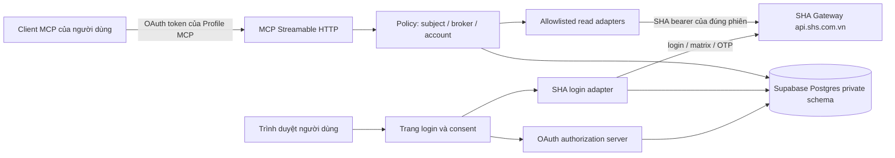

# Kiến trúc đề xuất

Checkpoint 09/10/2026: runtime Node 24/Express/official MCP SDK/oidc-provider đã deploy; xem [HANDOFF](HANDOFF.md). Mô tả bên dưới là kiến trúc mục tiêu; G1/G2/G4 còn mở. RPC EXECUTE-only và encrypted artifacts được chọn. ShaFlow lưu trong oauth_artifacts thay cho bảng auth_transactions; entitlement_snapshots chưa dùng, runtime đọc scope mới mỗi lần. Không có durable state trong RAM.

## 1. Quyết định

Một ứng dụng Node ESM/TypeScript trên Vercel gồm hai bề mặt: MCP Streamable HTTP tại `/api/mcp`, và website đăng nhập/ủy quyền tại cùng origin. Supabase Postgres lưu phiên, challenge và trạng thái OAuth. Kết nối SHA chỉ thực hiện từ backend qua HTTPS, không cần Electron.

Không có kết nối trực tiếp từ model tới SHA bearer. Đăng nhập SHA và cấp quyền MCP là hai bước liên quan nhưng không dùng chung token.

## 2. Thành phần dự kiến

| Thành phần | Trách nhiệm | Không được làm |
|---|---|---|
| OAuth AS | Discovery, authorization code + PKCE, consent, token/revocation | Nhận SHA bearer làm token MCP |
| Login web | ID/password, hiển thị matrix/challenge, nhận OTP | Ghi mật khẩu/OTP vào DB hoặc log |
| SHA auth adapter | Ba request cố định, bootstrap identity | Bắt token từ Electron/cookie máy người dùng |
| Session store | Ciphertext SHA token, vòng đời, revoke, generation | Một token global cho cả team |
| Scope resolver | Kiểm broker tree, account membership, subId | Tin brokerCode/remNo từ model |
| Route adapters | Xây request allowlist và parse shape riêng | URL/path/method tùy ý, tự fallback |
| DTO mapper | Field allowlist, unit/null/coverage/provenance | Trả raw JSON tràn ra model |
| Metadata tools | Danh mục thực sự đã bật, mô tả dữ liệu | Quảng cáo mọi candidate như đã hoạt động |

Thư mục code dự kiến: `src/mcp`, `src/auth`, `src/sha/auth`, `src/sha/read`, `src/policy`, `src/store`, `src/crypto`, `src/dto`, `src/observability`, `app` hoặc `api` theo framework chọn ở G0; `tests/fixtures/synthetic`, `tests/contract`, `tests/security`, `tests/live`.

## 3. Stateless và consistency

- Mỗi request MCP có đủ bearer MCP để resolve subject/session; không phụ thuộc warm instance hoặc sticky session.
- SDK chạy chế độ stateless thích hợp cho Streamable HTTP. Không tự xây JSON-RPC. Khởi tạo/lifecycle/concurrent requests được kiểm với client SDK và Vercel preview.
- Không giữ durable MCP session, login challenge, refresh lock hoặc quota trong biến global. Cache trong process chỉ là tối ưu có thể bỏ, không quyết định quyền.
- Request mang `sessionGeneration` và `entitlementVersion`. Trước trả kết quả, kiểm generation chưa bị revoke/đổi; response cũ không được trả sau logout/account switch.
- Không coi một response gộp từ nhiều endpoint là snapshot nguyên tử. Ghi thời điểm fetch từng phần và `snapshotConsistency: nonAtomic`.
- Database unavailable: fail closed với lỗi tạm thời. Không dùng phiên cache cũ để vượt check revoke/quyền.

## 4. Identity và mô hình team

Baseline: mỗi người nội bộ dùng tài khoản SHA của chính mình; admin cấu hình allowlist identity trong Profile MCP. Quyền xem thực tế là giao của quyền SHA, quyền team nội bộ và scope OAuth đã consent. Team admin của MCP không tự có quyền quản lý tài khoản chứng khoán của người khác.

Không đồng nhất ba giá trị: `preferredUsername` (login), `brokerCode` (môi giới), `accountNo/subId` (khách hàng/tiểu khoản). Một vài route đặt tên `remNo` nhưng nhận login; binding cụ thể nằm trong catalog, không có quy tắc thay thế chung.

Một upstream session gắn một user và một OAuth grant/connection. Nhiều client có thể đăng nhập riêng; không mặc định gộp token. G1 phải thử việc SHA có thu hồi phiên cũ khi login mới. Nếu có, UI phải thông báo reconnect thay vì retry ngầm hoặc dùng tài khoản chung.

## 5. Điều kiện kỹ thuật chưa chốt

Chọn framework và OAuth AS sau spike. Ứng viên là official MCP TypeScript SDK + handler tương thích, Next.js Route Handler hoặc Vercel Node handler, thư viện `oidc-provider` với adapter Postgres. Thư viện có các thành phần OAuth/PKCE/resource indicators cần thiết, nhưng khả năng chạy đúng trên Vercel và đáp ứng client MCP phải được kiểm trước khi quyết định. [Nguồn thư viện](https://github.com/panva/node-oidc-provider).

Chưa chọn phiên bản dependency bằng suy đoán. G0 kiểm registry, engine Node, exports ESM, handler/SDK compatibility, native import và preview; pin phiên bản/lockfile sau đó. Không mang `better-sqlite3`, Electron, Windows safeStorage hoặc SQLCipher của SHA PC lên Vercel.

Các giới hạn duration, vùng deploy, kết nối database và gói Vercel/Supabase được kiểm theo account thực lúc triển khai; không dựa vào con số gói cố định trong tài liệu này.
