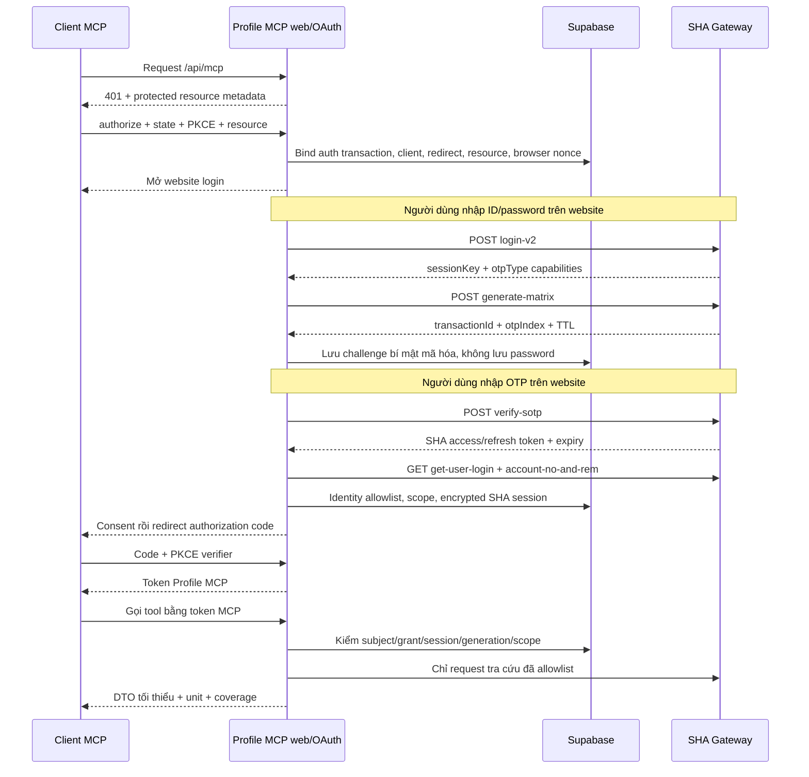

# Đăng nhập SHA và phiên MCP

Checkpoint 09/10/2026: đã implement control plane và OAuth, 13 tests synthetic tổng thể passed; chưa live login SHA. Claude lỗi DCR trước form, GPT chưa test. Quyết định runtime/các khác biệt còn thiếu ghi trong [HANDOFF](HANDOFF.md); các flow dưới là hợp đồng mục tiêu, không tự chứng minh live acceptance.

## 1. Hai lớp xác thực

Client MCP dùng **token do Profile MCP cấp**. Backend giữ **bearer SHA được mã hóa** để gọi upstream. Token của lớp này không được dùng thay token lớp kia. Đây là OAuth authorization code với PKCE S256 theo thiết kế MCP; tài liệu chuẩn yêu cầu resource server xác thực token phù hợp resource/audience và công bố metadata. [MCP Authorization](https://modelcontextprotocol.io/specification/2025-11-25/basic/authorization).

Website đăng nhập là nơi duy nhất nhận ID/password/OTP. Model không thấy những trường này và không có tool login/verify/refresh/logout. Người dùng có thể disconnect trên website; thao tác quản lý phiên không thay đổi tài khoản/giao dịch SHA.

## 2. Luồng end to end

Consent phải hiển thị đúng client, tài khoản SHA hiện tại và phạm vi đọc. Không tự đồng ý client mới dựa vào đăng nhập sẵn. Browser interaction cookie HttpOnly, Secure, SameSite thích hợp luồng redirect; mọi form POST có CSRF token và kiểm Origin. Redirect URI so khớp chính xác đăng ký, không wildcard tùy ý.

## 3. Contract SHA lịch sử — cần G1 xác minh

Host cố định `https://api.shs.com.vn`; prefix `/prod/v1/author-service/p/auth/`. Schema success vẫn cần check envelope trước khi đọc data.

| Bước | Method/path | Body allowlist | Trường trả về được dùng |
|---|---|---|---|
| A1 | POST login-v2 | username, password | username, sessionKey, trustDevice, otpType[] |
| A2 | POST generate-matrix | username, sessionKey, trustDevice, otpType từ transaction A1 | username, otpIndex, transactionId, remainSeconds; note chỉ để hiển thị đã escape |
| A3 | POST verify-sotp | username, sessionKey, trustDevice, otpType=`2`, transactionId, otp | access_token, refresh_token, token_type, expires_in, refresh_expires_in |

`otpType` ở A1/A2 là capability theo nguồn, A3 chọn SOTP/matrix `2` được mô tả. Không tự suy mapping `5` hoặc SMS từ SHSmart. Nếu server trả capability khác, UI báo chưa hỗ trợ và dừng; không thử brute-force loại OTP.

Tài liệu SHA có mâu thuẫn header: một nguồn gửi `Authorization: Bearer null` cho public auth, nguồn chuyển đổi nói không cần bearer. G1 cần xác minh một profile request chính thức; không lần lượt retry credentials trên nhiều biến thể. Chưa đưa header giả vào code production.

Không coi capture token trong Electron là API đăng nhập server. Các interceptor `account_ipc.js` và browser storage của ứng dụng nguồn chỉ giải thích môi trường cũ; không port.

### Sau A3

- GET `/prod/v2/sha-service/e/user/get-user-login`: lấy danh tính authoritative, brokerCode, preferredUsername, branch và role/scope liên quan.
- GET `/prod/v2/sha-service/e/account/account-no-and-rem`: lấy scope được SHA trả cho token hiện tại. Không tự dựng scope từ input model.
- Đối chiếu user với allowlist nội bộ trước cấp MCP grant. Tài khoản SHA hợp lệ nhưng chưa được allowlist không có quyền truy cập Profile MCP.
- JWT decode chỉ để đọc metadata, không chứng minh chữ ký. Nếu chọn xác minh JWT tại backend: pin issuer SHA đã kiểm, allowlist JWKS URL, kiểm alg/kid/signature/aud/exp; `aud` và discovery/JWKS còn phải xác minh ở G1. Không fetch URL từ `iss` tùy ý trong token. Có thể dùng token mới do TLS login trả + authoritative API response để bootstrap khi JWT verification chưa được cấu hình, nhưng không nhận bearer SHA do client MCP tự đưa vào.
- `accessExpiresAt` lấy expiry do SHA chứng minh; nếu có cả exp và expires_in thì dùng giới hạn sớm hơn, trừ clock skew 60 giây (chính sách đề xuất). Không hardcode 8 giờ.
- Chưa có contract refresh được chứng minh. `/auth/refresh-token` chỉ được nhắc tên; **không gọi tự động**. Session hết hạn chuyển `reauth_required`. MCP refresh token chỉ gia hạn quyền MCP khi SHA session vẫn hợp lệ; nó không tự gia hạn SHA.

## 4. State machine và đồng thời

Auth transaction: `created → password_submitted → challenge_ready → verifying → succeeded`, hoặc `failed/expired/cancelled`. Password/OTP không ghi vào transaction; chỉ lưu challenge ciphertext cần cho bước sau.

- Claim bước verify bằng compare-and-swap trạng thái/version hoặc row lock ngắn; không giữ transaction DB suốt thời gian gọi mạng.
- Một OTP submission chỉ được thực thi bởi một worker. Double click nhận trạng thái đang xử lý, không gửi lại upstream.
- Nếu verify timeout, kết quả có thể không biết chắc. Không tự replay OTP; chuyển trạng thái cần bắt đầu lại hoặc kiểm chứng theo contract upstream đã biết.
- Challenge expire dựa remainSeconds từ SHA, với upper bound do ứng dụng đặt; xóa secret sau thành công/hết hạn. Không hardcode TTL upstream.
- Upstream session: `active → expired/reauth_required/revoked`; token replace tăng generation. Grant chỉ active nếu session cùng subject/team/generation còn active.
- Logout/disconnect revoke grant và session của connection tương ứng trong một transaction; request đang chạy phải check generation lại trước trả dữ liệu.
- Khi sau này bật refresh SHA: lock lease có expiry + fencing version, một refresh thực thi, lưu cặp access/refresh mới nguyên tử; token rotation thất bại không tái dùng refresh token cũ. Chỉ triển khai sau Q02.

## 5. OAuth AS và client registration

Dùng thư viện chuẩn có authorization code, PKCE S256, discovery, resource indicators, token endpoint, revocation và storage adapter. `oidc-provider` là ứng viên, chưa được quyết định/pin. G0 phải chứng minh chạy trên Vercel và persistence/atomic consume trong Supabase.

Expose protected-resource metadata, authorization-server metadata, authorize, token, revoke và endpoints thư viện yêu cầu. URL cuối phải khớp issuer production cố định. Client chưa đăng ký có thể dùng cơ chế pre-registration/CIMD/DCR mà thư viện và client thực hỗ trợ; lựa chọn cụ thể chốt tại G0/G4. Dynamic registration nếu bật cần quota và validation redirect/client metadata, không nhận URL nội bộ/localhost ngoài trường hợp localhost native client được chuẩn cho phép và đã thiết kế riêng.

MCP token phải bind client_id, subject, team, resource, scope, grant và session generation. Với opaque token: lưu digest HMAC, lookup server-side. Với JWT: kiểm chữ ký và claims, vẫn check revoke/session trong store. Token payload và cookie không chứa bearer SHA. [MCP security: token passthrough và confused deputy](https://modelcontextprotocol.io/docs/2025-11-25/tutorials/security/security_best_practices).

TTL nội bộ đề xuất để kiểm thử, chưa phải thông số SHA: authorization code 60 giây và dùng một lần; access token MCP 10 phút nhưng không quá thời hạn session; rotating MCP refresh tối đa 7 ngày nhưng không vượt session SHA/revoke. Authorization-server library quản lý rotation/replay, adapter phải triển khai atomicity được test.

## 6. Phân quyền request

1. Xác minh token MCP, resource và scope.
2. Resolve user/team/connection/session còn active, phiên bản quyền hiện tại.
3. Resolve accountRef, brokerRef, subaccountRef tenant-bound. Reference opaque là tiện ích, không thay thế kiểm quyền.
4. Các brokerCode/remNo/emNo/tlId/custid upstream lấy từ danh tính và cây quyền; public input không có các field này.
5. Account thuộc broker được phép, subId thuộc account, filter ngày/range hợp lệ. Broker scope không rõ phải báo AMBIGUOUS_SCOPE, không lấy root đầu tiên.
6. Gọi route cố định; validate account/subaccount/broker trong response. Nếu nguồn không có đủ identity fields, đối chiếu bằng contract route và request binding đã nghiệm thu; không đoán từ dòng đầu.
7. Nested rows phải kiểm hoặc bỏ khỏi DTO. Pagination scope drift => lỗi, không xuất một phần dữ liệu trái quyền.
8. Check generation/revoke lần cuối rồi trả DTO.

Cache quyền gợi ý tối đa 60 giây, gắn session và version; thời hạn cụ thể là policy cần test. Trường hợp thay đổi quyền có yêu cầu thu hồi tức thời phải invalidate chủ động hoặc fetch mỗi request. Không tuyên bố revoke upstream tức thời nếu chỉ TTL cache.

## 7. Dữ liệu tối thiểu

Scope đề xuất: `profile.read`, `accounts.read`, `assets.read`, `orders.read`, `credit.read`, `reports.read`, `research.read`, `market.read`; `profile.pii` tách riêng và mặc định không cấp. Scope `openid` chỉ dùng nếu OAuth library thực triển khai OIDC, không tự thêm vì tên thư viện.

Log không chứa Authorization, cookie, username/password, OTP, access/refresh token, request/response body tài khoản. Audit chỉ operation, subject ID nội bộ/hmac, request ID, result code, duration, row count và gate version. Không đẩy PII vào analytics/tracing.
